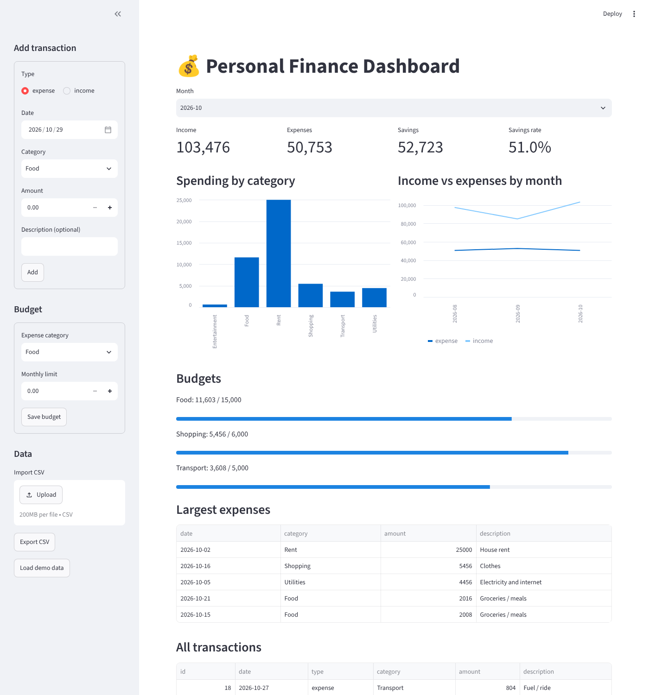

# Personal Finance Dashboard

A web dashboard for tracking income and expenses, built with **Python, Streamlit, SQLite and pandas**. Add transactions, set monthly budgets, and see where your money goes with live charts.

**[Live demo](https://personal-finance-dashboard-demo.streamlit.app)**



## Features

- **Income and expense tracking** with date, category and description.
- **Monthly summary** – income, expenses, savings and savings rate.
- **Charts** – spending by category and income vs expenses trend.
- **Budgets** – monthly limit per category with progress bars and over-budget warnings.
- **CSV import and export** – invalid rows are skipped and reported instead of crashing.
- **Input validation** – rejects negative amounts, invalid dates and unknown types.
- **19 automated tests** covering storage, validation, analytics and an app smoke test.

## Getting Started

```bash
git clone https://github.com/shifafaheem05-lgtm/personal-finance-dashboard.git
cd personal-finance-dashboard

python -m venv venv
venv\Scripts\activate          # Windows
# source venv/bin/activate     # macOS / Linux

pip install -r requirements.txt
streamlit run app.py
```

Click **Load demo data** in the sidebar to try it with sample numbers. Run the tests with `python -m unittest discover -s tests -t .`

## Project Structure

```
app.py                 Streamlit user interface
finance/
├── db.py              SQLite storage, validation, CSV import/export
├── analytics.py       pandas functions: summaries, trends, budgets
└── demo.py            fictional demo data
tests/                 unit tests + app smoke test
```

## Author

**Shifa Faheem** – [GitHub](https://github.com/shifafaheem05-lgtm) · [LinkedIn](https://www.linkedin.com/in/shifa-faheem-dev)

Released under the [MIT License](LICENSE).
